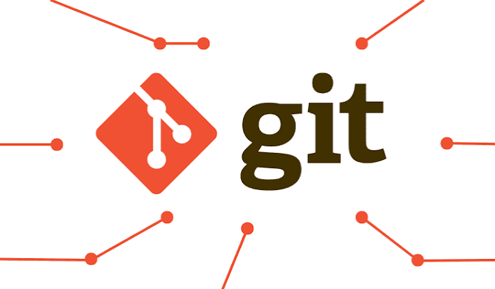
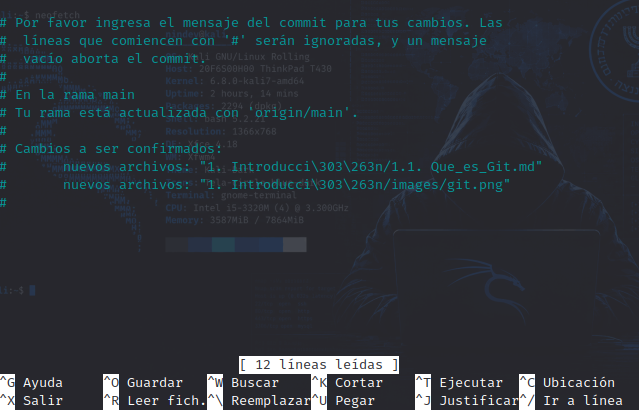

# Qué es GIT?



Imagina que estás escribiendo una novela muy importante o armando un proyecto complejo. A medida que avanzas, haces cambios, borras párrafos, pruebas ideas nuevas y, a veces, te arrepientes y deseas con toda el alma poder volver atrás en el tiempo tal como estabas el martes pasado.

Git es, básicamente, una máquina del tiempo y un asistente personal invisible diseñado exactamente para eso, especialmente pensado para quienes escriben código.

Git almacena y maneja la información de forma
muy diferente a otros sistemas, a pesar de que su interfaz de usuario es bastante
similar. Comprender esas diferencias evitará que te confundas a la hora de usarlo. (_libro Pro Git pág. 13_)

## ¿Cómo funciona en la práctica?

Para entenderlo sin tecnicismos, Git se divide en tres ideas clave con las que te sentirás muy familiarizado:

1. **Puntos de control (Commits)**: Cada vez que terminas algo que funciona o logras un avance significativo, le dices a Git: _"Oye, guarda este momento exacto"_. A ese paquete de cambios se le llama **commit**. Le pones una pequeña nota descriptiva (como _"agregué la página de contacto"_), y listo. Si algo se rompe más adelante, puedes regresar a ese punto exacto con un solo clic.

```bash
# comando para hacer el commit
git commit -m "agregué la página de contacto."

# La opción -m significa message y permite escribir el mensaje del commit directamente en el comando, sin abrir un editor de texto.
```

Si lo que hacemos es escribir solamente:

```bash
git commit
```

Git abre el editor de texto configurado para que escribamos el mensaje del commit.

Con `-m`: escribimos el mensaje directamente en el comando.

Sin `-m`: escribes el mensaje en el editor; debes guardar y cerrar para completar el commit.



2. **Universos paralelos (Ramas o Branches)**: ¿Alguna vez has querido probar una idea loca en tu proyecto, pero te da miedo arruinar lo que ya tienes funcionando? En Git puedes crear una "ramificación" o un universo paralelo. Trabajas en tu idea ahí sin alterar el proyecto principal (main). Si el experimento sale bien, lo integras; si sale mal, simplemente borras ese universo alternativo y aquí no ha pasado nada.

```bash
# Esto crea la rama develop y te transporta a ella de inmediato.

git checkout -b develop

# La manera actualizada de hacerlo es:
git switch -c develop
```

Hace exactamente lo mismo, pero el comando `switch`(introducido en versiones recientes de Git) es mucho más intuitivo porque su única misión es cambiar de rama.

### ¿Y si usas solo git branch develop?

Si omites la `-b`, Git creará el universo paralelo (develop), pero te dejará en el universo donde estabas (en tu rama principal). Solo creará la puerta, pero no la cruzará. Para cruzarla después tendrías que usar `git switch develop` (o `git checkout develop`).

- `-b` (en `git checkout -b`): Viene de branch (rama). Le dice al comando tradicional que cree la rama y se mueva a ella de inmediato.
- `-c` (en `git switch -c`): Viene de create (crear). Cumple exactamente la misma función, pero está diseñado específicamente para el comando moderno switch.

3. **El fin del caos de archivos**: Dile adiós para siempre a nombres de archivos tan desesperantes como proyecto_final_v2_DEFINITIVO_ahora_si.js. Con Git, tienes un solo archivo limpio y ordenado, y el historial completo vive guardado discretamente en segundo plano.

### Checkout

En inglés, la palabra checkout tiene varios significados (como pagar en una tienda o registrar la salida de un hotel), pero en el mundo de Git viene a significar algo así como "extraer", "revisar" o "mudarse a".

Históricamente, en Git el comando checkout era el comodín para todo lo relacionado con moverte a través del tiempo o del espacio de tu proyecto.

### El problema de checkout

El motivo por el cual los creadores de Git decidieron crear comandos nuevos y más específicos como `switch` (para cambiar de ramas) y `restore` (para recuperar archivos) es que checkout hacía demasiadas cosas diferentes dependiendo de cómo lo combinaras, lo que solía confundir mucho a los principiantes.
